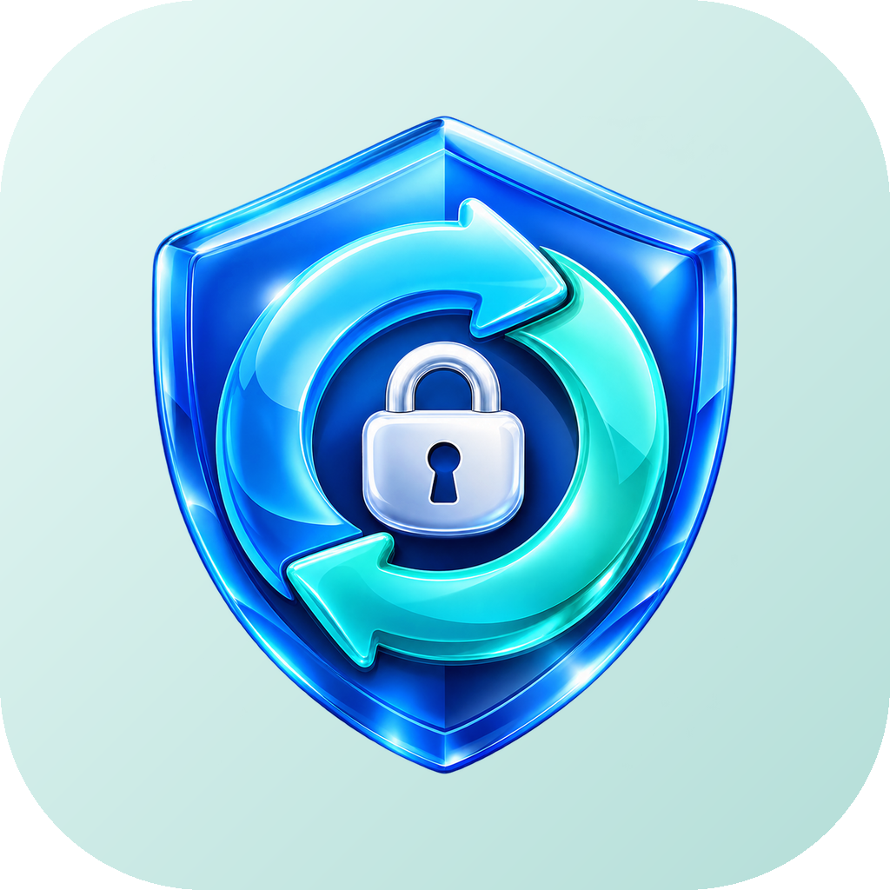

# OpenSync



**Szyfrowane kopie zapasowe telefonu w sieci domowej.** Interfejs jest czarno-biały, w stylu OpenPDF, bez reklam i śledzenia. Telefon szyfruje dane, zanim wyśle je na NAS, serwer albo dysk USB. Kolejne kopie wysyłają tylko zmiany, a liczbę przechowywanych wersji ustalasz sam.

[](../../actions/workflows/android.yml)

## Pobieranie

Najnowszy plik jest zawsze w **[Releases → Latest](../../releases/latest)**. Każdy wypchnięty tag `vX.Y.Z` buduje i publikuje nową wersję automatycznie, a aplikacja sama proponuje aktualizację.

1. Pobierz `OpenSync-x.y.z.apk` na telefon.
2. Otwórz plik i zezwól na instalację z tego źródła.
3. Dodaj miejsce kopii, utwórz zadanie i ustaw hasło szyfrowania.
4. Wymagany Android 10 (API 29) lub nowszy.

## Funkcje

### Co kopiuje
| Źródło | Zawartość |
|---|---|
| **SMS i MMS** | Wszystkie SMS w formacie zgodnym z importem w OpenSMS oraz MMS z załącznikami. |
| **Połączenia** | Historia w JSON i CSV. |
| **Kontakty** | Plik vCard do importu w dowolnej aplikacji kontaktów. |
| **Kalendarze** | Każdy kalendarz jako osobny plik `.ics`, z powtarzaniem wydarzeń. |
| **Zdjęcia, filmy, audio, pobrane** | Z pamięci wewnętrznej i kart SD, ze strukturą folderów. |
| **Wybrane foldery** | Dowolne foldery, także eksporty innych aplikacji, rekurencyjnie. |
| **Aplikacje** | Lista zainstalowanych aplikacji, opcjonalnie pliki APK (z dzielonymi APK). |
| **Urządzenie** | Model, wersja systemu i ustawienia OpenSync (bez haseł). |

### Dokąd
| Cel | Opis |
|---|---|
| **SMB 2/3** | Synology, QNAP, TrueNAS, Unraid, Samba, Windows; konto, gość lub anonimowo. |
| **SFTP** | Hasło lub klucz prywatny; klucz serwera zapamiętywany przy pierwszym połączeniu, a jego zmiana blokuje kopię. |
| **WebDAV** | Nextcloud, ownCloud, Synology WebDAV, rclone; opcjonalnie certyfikat samopodpisany. |
| **Folder / USB** | Pamięć telefonu, karta SD, dysk OTG (Storage Access Framework). |

Dodatkowo: wyszukiwanie serwerów w sieci (mDNS) i **Wake-on-LAN**, czyli wybudzenie uśpionego NAS-a przed kopią.

### Bezpieczeństwo
- Szyfrowanie po stronie telefonu: **AES-256-GCM**, klucz z hasła przez **PBKDF2-HMAC-SHA256** (600 000 iteracji).
- Losowy klucz główny jest zapisany w repozytorium zaszyfrowany hasłem, więc zmiana hasła nie wymaga ponownego szyfrowania danych.
- Identyfikatory fragmentów to HMAC-SHA256 ich treści. Serwer nie zna nazw plików, ich rozmiarów w kopii ani skrótów treści.
- Każdy fragment jest uwierzytelniony; podmiana albo uszkodzenie jest wykrywane.
- Hasła do serwerów i repozytoriów są przechowywane zaszyfrowane kluczem z **Android Keystore**.

### Wersje i retencja
- Każda kopia jest pełna i daje się przywrócić samodzielnie, a niezmienione dane są współdzielone (deduplikacja).
- Reguły: N ostatnich, godzinowe, dzienne, tygodniowe, miesięczne, roczne, „wszystkie z ostatnich N dni”. Gotowe warianty: Oszczędnie, Zrównoważony, Archiwum.
- Przypięte kopie nigdy nie są usuwane. Po usunięciu kopii zwalniane są tylko fragmenty, z których nie korzysta żadna inna kopia.
- Kilka telefonów może zapisywać do jednego repozytorium. Blokady chronią przed jednoczesnym porządkowaniem.

### Harmonogram i warunki
- Ręcznie, co N godzin, codziennie lub co tydzień o wybranej porze.
- Kopia kilka minut po zrobieniu zdjęcia lub filmu.
- Tylko Wi-Fi bez limitu, tylko wybrane sieci domowe (SSID), tylko podczas ładowania, nie przy niskiej baterii, gdy telefon jest nieużywany.
- Ponawianie, gdy NAS jest niedostępny (np. poza domem).
- Filtry: wzorce wykluczeń, maksymalny rozmiar pliku, pomijanie ukrytych, multimedia tylko z ostatnich N dni.
- Kompresja (wyłączona, szybka, standardowa, maksymalna), z automatycznym pominięciem plików już skompresowanych. Do tego wielkość fragmentu i limit prędkości wysyłania.

### Przywracanie i kontrola
- Przeglądanie każdej kopii jak folderu, wyszukiwanie, zaznaczanie wielu plików.
- Przywracanie całości, folderu lub wybranych plików do wskazanego miejsca.
- Otwarcie lub udostępnienie pojedynczego pliku z kopii: vCard importuje się do Kontaktów, a `.ics` do Kalendarza.
- Porównanie dwóch kopii: nowe, zmienione i usunięte pliki.
- Weryfikacja po co N-tej kopii (obecność wszystkich fragmentów i kryptograficzne sprawdzenie próbki) oraz pełna weryfikacja na żądanie.
- Historia z czasem trwania, rozmiarem, wysłanymi danymi i ostrzeżeniami.
- Eksport i import ustawień (bez haseł), zmiana hasła repozytorium.

## Odzyskiwanie na komputerze

Do każdego wydania dołączony jest `opensync-restore.py`. Przywraca kopie bez telefonu, prosto z zamontowanego udziału NAS:

```bash
pip install cryptography
python opensync-restore.py Z:/backup/OpenSync list
python opensync-restore.py Z:/backup/OpenSync restore latest ./odzyskane
```

Dostępne są też polecenia `files` (lista plików w kopii, `--grep`) i `check` (spójność, `--full` sprawdza każdy fragment).

## Format repozytorium

```
config                    parametry KDF i zaszyfrowany klucz główny (JSON)
snapshots/<czas>_<zadanie>_<losowe>   zaszyfrowany manifest kopii
data/<2 znaki>/<id>       zaszyfrowane fragmenty plików, id = HMAC-SHA256 treści
locks/                    blokady urządzeń
pins                      przypięte kopie
```

Blok: `[1][nonce 12 B][AES-GCM(flaga kompresji + dane) + tag]`, z identyfikatorem jako AAD.

## Aktualizacje

Aplikacja sprawdza przy starcie najnowsze wydanie na GitHubie. Baner „Nowa wersja” pobiera APK i instaluje go przez systemowy instalator.

## Budowanie

```bash
gradle :app:assembleDebug
```

Wymagane są JDK 17 i Android SDK (compileSdk 36). Wydanie powstaje na GitHub Actions wyłącznie po wypchnięciu tagu `vX.Y.Z` zgodnego z plikiem `VERSION` (np. `git tag v1.0.0 && git push origin v1.0.0`). Podpis pochodzi z sekretów `SIGNING_KEYSTORE_BASE64`, `SIGNING_STORE_PASSWORD`, `SIGNING_KEY_ALIAS`, `SIGNING_KEY_PASSWORD`.

### Struktura
| Katalog | Zawartość |
|---|---|
| `crypto/` | Szyfrowanie, KDF, identyfikatory fragmentów, kompresja. |
| `repo/` | Repozytorium: fragmenty, kopie, retencja, porządkowanie, weryfikacja. |
| `backend/` | SMB, SFTP, WebDAV, folder SAF, Wake-on-LAN. |
| `sources/` | Źródła danych: SMS/MMS, połączenia, kontakty, kalendarz, multimedia, foldery, aplikacje. |
| `engine/` | Kopia, przywracanie, weryfikacja, postęp. |
| `work/` | WorkManager: harmonogram, warunki, powiadomienia. |
| `update/` | Aktualizacje z GitHub Releases. |
| `ui/` | Interfejs w Jetpack Compose. |
| `tools/` | Narzędzie odzyskiwania na komputer. |

## Licencja

MIT – zobacz [LICENSE](LICENSE).
